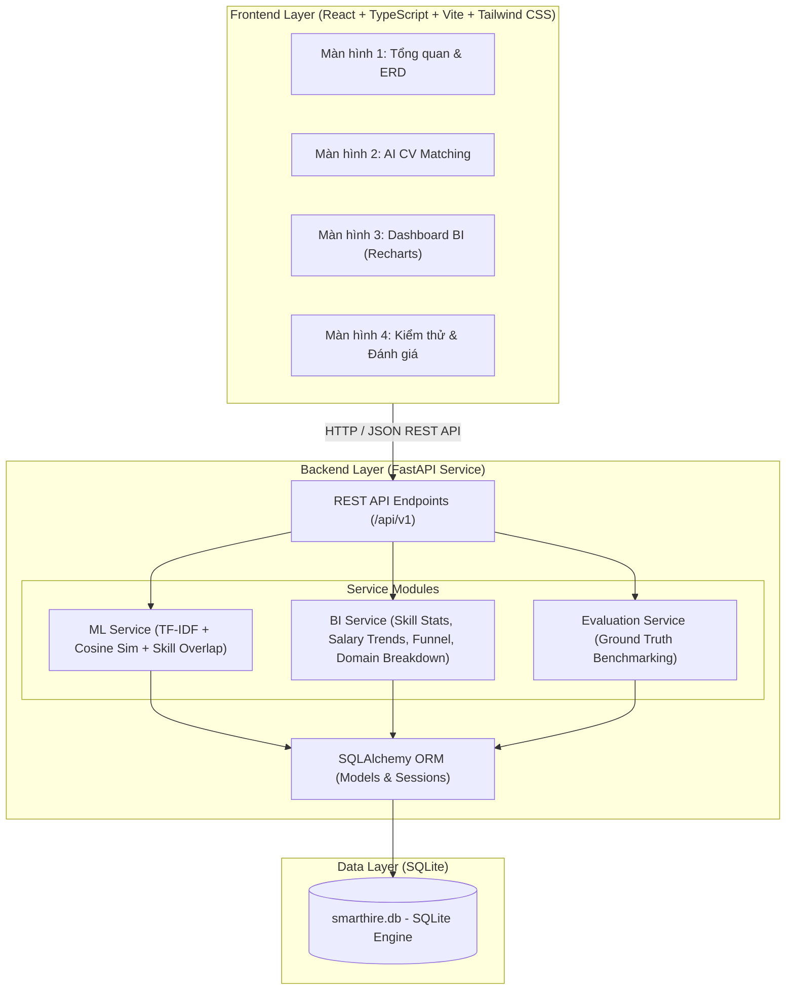

# SMARTHIRE MINI — KIẾN TRÚC HỆ THỐNG VÀ THIẾT KẾ DATABASE (CHECKLIST 1)
**Nhóm thực hiện**: Group 8  
**Đề tài**: Hệ thống tìm việc thông minh tích hợp AI (CV Matching) và BI (Business Intelligence)  

---

## 1. PHÂN TÍCH YÊU CẦU NGHIỆP VỤ

### 1.1. Đối tượng sử dụng
- **Ứng viên (Candidate)**: Tìm kiếm việc làm phù hợp, kiểm tra độ tương thích giữa nội dung CV cá nhân và JD của nhà tuyển dụng, nhận biết kỹ năng đạt được và kỹ năng còn thiếu để hoàn thiện hồ sơ.
- **Nhà tuyển dụng / Quản lý HR (Employer/Recruiter)**: Đăng tin tuyển dụng (Job Description), tự động đánh giá độ phù hợp của hồ sơ ứng viên bằng AI, theo dõi số liệu và các chỉ số chuyển đổi phễu tuyển dụng qua Dashboard BI.

### 1.2. Các chức năng chính
1. **Quản lý dữ liệu mẫu**: Lưu trữ danh mục ứng viên, nhà tuyển dụng, tin tuyển dụng, kỹ năng chuẩn hóa và hồ sơ ứng tuyển theo chuẩn quan hệ CSDL.
2. **AI/ML CV Matching**:
   - Trích xuất và chuẩn hóa kỹ năng từ CV và JD theo từ điển kỹ năng chuẩn hóa (Rule-based Dictionary).
   - Vector hóa văn bản bằng TF-IDF (`TfidfVectorizer` từ scikit-learn) dựa trên tập văn bản nền (corpus tham chiếu từ toàn bộ JD/CV).
   - Đo độ tương đồng ngữ nghĩa bằng Cosine Similarity (trọng số 60%).
   - Đo tỷ lệ kỹ năng đáp ứng (Skill Match Ratio, trọng số 40%).
   - Trả về Matching Score (0 - 100%), danh sách kỹ năng phù hợp, kỹ năng còn thiếu và thời gian suy luận thực đo (`inference_time_ms`).
3. **Dashboard BI**:
   - Thống kê phân bố ứng viên và nhu cầu tuyển dụng theo kỹ năng (Cung vs Cầu, hỗ trợ bộ lọc danh mục).
   - Phân tích xu hướng mức lương trung bình theo thời gian (từ tin tuyển dụng mô phỏng, đơn vị triệu VNĐ/tháng).
   - Phân tích phễu chuyển đổi qua các vòng tuyển dụng: `Nộp hồ sơ` -> `Duyệt hồ sơ` -> `Phỏng vấn` -> `Nhận việc`.
   - Phân tích phân bố việc làm & mức lương theo nhóm chuyên môn (Backend, Frontend, Data/AI, DevOps).
   - Hệ thống nhận xét BI tự động sinh bằng quy tắc (Rule-based Insights).
4. **Kiểm thử & Đánh giá**:
   - Chạy test tự động với bộ 12 test case thực tế bao phủ Database, API, ML, BI và các trường hợp biên.
   - Đo lường Precision, Recall, F1 trên tập 12 cặp CV/JD được gán nhãn thực nghiệm.

### 1.3. Yêu cầu phi chức năng
- **Mục tiêu hiệu năng thiết kế**: Thời gian phân tích CV dưới 500ms cho 1 cặp CV/JD (thực tế đo kiểm đạt 2ms – 15ms trên máy cá nhân).
- **Tính độc lập & Nhẹ gọn**: Sử dụng SQLite không cần cài đặt RDBMS phức tạp; chạy trực tiếp bằng một lệnh hoặc script tự động.
- **Tính nhất quán dữ liệu**: Bộ dữ liệu mẫu được khởi tạo xác thực thông qua kịch bản `seed_data.py`, đảm bảo tính nhất quán và khả năng tái lập kiểm thử trên mọi môi trường.
- **Bảo mật & Tối giản**: Không yêu cầu lưu trữ dữ liệu cá nhân nhạy cảm, không dùng API key trả phí hoặc dịch vụ đám mây bên thứ ba.

---

## 2. SƠ ĐỒ KIẾN TRÚC HỆ THỐNG (SYSTEM ARCHITECTURE)

Hệ thống được xây dựng theo kiến trúc ba tầng phân lớp độc lập (3-Tier Architecture):



---

## 3. THIẾT KẾ CƠ SỞ DỮ LIỆU & SƠ ĐỒ ERD (ENTITY RELATIONSHIP DIAGRAM)

### 3.1. Danh sách 7 thực thể CSDL (Đối chiếu chính xác với SQLAlchemy Models)

1. `employers` (Nhà tuyển dụng): Lưu thông tin doanh nghiệp (`id`, `name`, `industry`, `location`, `website`).
2. `candidates` (Ứng viên): Lưu thông tin hồ sơ ứng viên (`id`, `full_name`, `email`, `phone`, `years_of_experience`, `current_title`, `cv_text`, `created_at`).
3. `jobs` (Tin tuyển dụng): Lưu chi tiết yêu cầu công việc (`id`, `employer_id`, `title`, `description`, `requirements`, `min_experience_years`, `salary_min`, `salary_max`, `currency`, `posted_date`, `status`).
4. `skills` (Từ điển kỹ năng): Danh mục kỹ năng chuẩn hóa (`id`, `name`, `category`).
5. `candidate_skills` (Kỹ năng ứng viên): Bảng liên kết N-N giữa ứng viên và kỹ năng (`candidate_id`, `skill_id`, `proficiency_level`).
6. `job_skills` (Yêu cầu kỹ năng công việc): Bảng liên kết N-N giữa tin tuyển dụng và kỹ năng yêu cầu (`job_id`, `skill_id`, `is_required`).
7. `applications` (Đơn ứng tuyển): Ghi nhận hồ sơ ứng tuyển và tiến trình phễu (`id`, `candidate_id`, `job_id`, `applied_date`, `stage`, `match_score`, `notes`).

### 3.2. Sơ đồ Quan hệ Thực thể (ERD) với Bội số Quan hệ

```mermaid
erDiagram
    EMPLOYERS ||--o{ JOBS : "1-N (Một công ty có nhiều tin tuyển dụng)"
    CANDIDATES ||--o{ CANDIDATE_SKILLS : "1-N (Một ứng viên có nhiều kỹ năng)"
    SKILLS ||--o{ CANDIDATE_SKILLS : "1-N (Một kỹ năng thuộc về nhiều ứng viên)"
    JOBS ||--o{ JOB_SKILLS : "1-N (Một công việc yêu cầu nhiều kỹ năng)"
    SKILLS ||--o{ JOB_SKILLS : "1-N (Một kỹ năng được yêu cầu ở nhiều công việc)"
    CANDIDATES ||--o{ APPLICATIONS : "1-N (Một ứng viên nộp nhiều đơn)"
    JOBS ||--o{ APPLICATIONS : "1-N (Một công việc nhận nhiều đơn)"

    EMPLOYERS {
        int id PK "Khóa chính tự tăng"
        string name "Tên công ty"
        string industry "Ngành nghề kinh doanh"
        string location "Địa điểm đặt trụ sở"
        string website "Trang web chính thức"
    }

    CANDIDATES {
        int id PK "Khóa chính tự tăng"
        string full_name "Họ và tên ứng viên"
        string email UK "Địa chỉ email duy nhất"
        string phone "Số điện thoại liên hệ"
        int years_of_experience "Số năm kinh nghiệm"
        string current_title "Chức danh hiện tại"
        text cv_text "Toàn văn nội dung CV"
        datetime created_at "Thời gian tạo hồ sơ"
    }

    JOBS {
        int id PK "Khóa chính tự tăng"
        int employer_id FK "Khóa ngoại tham chiếu employers(id)"
        string title "Chức danh tuyển dụng"
        text description "Mô tả trách nhiệm công việc"
        text requirements "Yêu cầu chi tiết ứng viên"
        int min_experience_years "Số năm kinh nghiệm tối thiểu"
        float salary_min "Mức lương tối thiểu (triệu VNĐ)"
        float salary_max "Mức lương tối đa (triệu VNĐ)"
        string currency "Đơn vị tiền tệ (VND)"
        date posted_date "Ngày đăng tin"
        string status "Trạng thái tin (open/closed)"
    }

    SKILLS {
        int id PK "Khóa chính tự tăng"
        string name UK "Tên kỹ năng chuẩn hóa (duy nhất)"
        string category "Phân loại (Backend, Frontend, Data/AI, ...)"
    }

    CANDIDATE_SKILLS {
        int candidate_id PK_FK "Khóa ngoại tham chiếu candidates(id)"
        int skill_id PK_FK "Khóa ngoại tham chiếu skills(id)"
        int proficiency_level "Mức độ thành thạo (1-5)"
    }

    JOB_SKILLS {
        int job_id PK_FK "Khóa ngoại tham chiếu jobs(id)"
        int skill_id PK_FK "Khóa ngoại tham chiếu skills(id)"
        boolean is_required "Bắt buộc hay ưu tiên"
    }

    APPLICATIONS {
        int id PK "Khóa chính tự tăng"
        int candidate_id FK "Khóa ngoại tham chiếu candidates(id)"
        int job_id FK "Khóa ngoại tham chiếu jobs(id)"
        datetime applied_date "Ngày giờ nộp đơn"
        string stage "Giai đoạn (applied, screening, interview, offered)"
        float match_score "Điểm phù hợp ghi nhận"
        text notes "Ghi chú của hội đồng tuyển dụng"
    }
```

---

## 4. QUY TRÌNH KHỞI TẠO VÀ BẢO TOÀN DỮ LIỆU
1. **Tạo bảng**: Script `backend/app/database.py` dùng `Base.metadata.create_all(bind=engine)` để sinh schema SQLite.
2. **Khởi tạo dữ liệu**: Script `backend/app/seed_data.py` nạp:
   - 5 Nhà tuyển dụng mẫu (VNG Corporation, FPT Software, Viettel Solutions, Tiki, MoMo).
   - 20 Ứng viên với CV văn bản chân thực đa dạng ngành nghề.
   - 15 Tin tuyển dụng đầy đủ mô tả, mức lương và yêu cầu kinh nghiệm.
   - 28 Kỹ năng chuẩn hóa chia thành 5 danh mục nghiệp vụ.
   - 40 Đơn ứng tuyển phản ánh mô hình phễu chuẩn 4 giai đoạn ($40 \to 30 \to 16 \to 6$).
3. **Bảo toàn dữ liệu**: Database được tạo tự động nếu chưa có khi chạy `setup.bat` hoặc lệnh khởi động đầu tiên.
