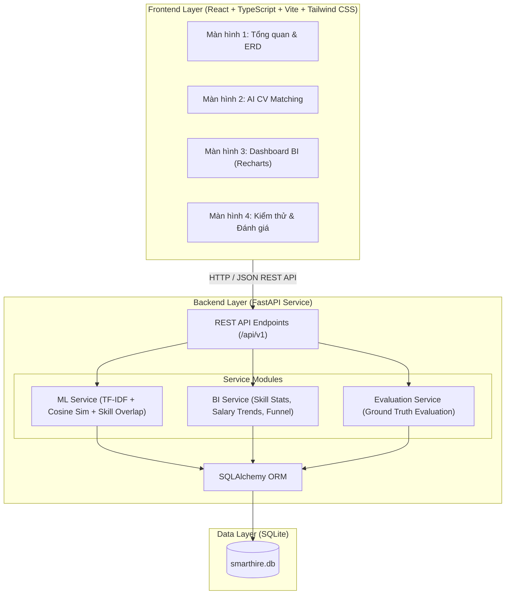
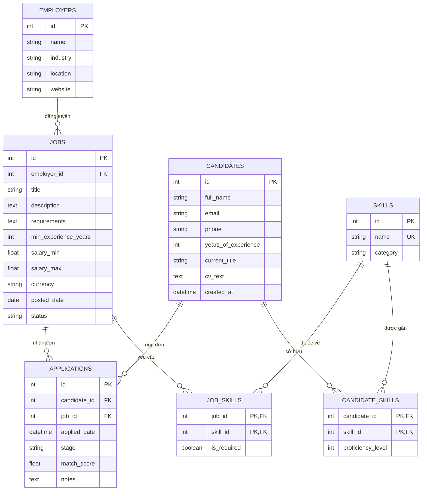

# SMARTHIRE MINI — KIẾN TRÚC HỆ THỐNG VÀ THIẾT KẾ DATABASE (CHECKLIST 1)
**Nhóm thực hiện**: Group 8  
**Đề tài**: Hệ thống tìm việc thông minh tích hợp AI (CV Matching) và BI (Business Intelligence)  

---

## 1. PHÂN TÍCH YÊU CẦU NGHIỆP VỤ

### 1.1. Đối tượng sử dụng
- **Ứng viên (Candidate)**: Tìm kiếm việc làm phù hợp, kiểm tra độ tương thích giữa CV cá nhân và JD của nhà tuyển dụng, nhận biết kỹ năng đạt được và kỹ năng còn thiếu.
- **Nhà tuyển dụng / Quản lý HR (Employer/Recruiter)**: Đăng tin tuyển dụng (Job Description), đánh giá độ phù hợp của hồ sơ ứng viên, theo dõi số liệu tuyển dụng tổng quan qua Dashboard BI.

### 1.2. Các chức năng chính
1. **Quản lý dữ liệu mẫu**: Lưu trữ danh mục ứng viên, nhà tuyển dụng, tin tuyển dụng, kỹ năng chuẩn hóa và đơn ứng tuyển.
2. **AI/ML CV Matching**:
   - Trích xuất và chuẩn hóa kỹ năng từ CV và JD theo từ điển kỹ năng chuẩn hóa.
   - Vector hóa văn bản bằng TF-IDF dựa trên tập văn bản nền (corpus tham chiếu).
   - Đo độ tương đồng ngữ nghĩa bằng Cosine Similarity (trọng số 60%).
   - Đo tỷ lệ kỹ năng đáp ứng (Skill Match Ratio, trọng số 40%).
   - Trả về Matching Score (0 - 100%), kỹ năng phù hợp, kỹ năng còn thiếu.
3. **Dashboard BI**:
   - Thống kê phân bố ứng viên theo kỹ năng kỹ thuật/chuyên môn.
   - Phân tích xu hướng mức lương trung bình theo thời gian (từ tin tuyển dụng mô phỏng, đơn vị triệu VNĐ/tháng).
   - Phân tích phễu chuyển đổi qua các vòng tuyển dụng: `Ứng tuyển` -> `Duyệt hồ sơ` -> `Phỏng vấn` -> `Nhận việc`.
4. **Kiểm thử & Đánh giá**:
   - Chạy test tự động với tối thiểu 10 test case thực tế.
   - Đo lường Precision, Recall, F1 trên tập 12 cặp CV/JD được gán nhãn thực nghiệm.

### 1.3. Yêu cầu phi chức năng
- **Hiệu năng**: Thời gian phân tích CV dưới 500ms cho 1 cặp CV/JD.
- **Tính độc lập & Nhẹ gọn**: Sử dụng SQLite không cần cài đặt RDBMS phức tạp; chạy trực tiếp bằng 1 lệnh.
- **Tính nhất quán**: Seed data có thể tái lập kết quả giống nhau 100% trên mọi máy tính.
- **Bảo mật**: Không yêu cầu lưu trữ dữ liệu cá nhân nhạy cảm, không dùng API key bên ngoài.

---

## 2. SƠ ĐỒ KIẾN TRÚC HỆ THỐNG (SYSTEM ARCHITECTURE)

---

## 3. THIẾT KẾ CƠ SỞ DỮ LIỆU & SƠ ĐỒ ERD (ENTITY RELATIONSHIP DIAGRAM)

### 3.1. Danh sách các thực thể (7 bảng)
1. `employers`: Thông tin công ty / nhà tuyển dụng.
2. `candidates`: Thông tin ứng viên (họ tên, email, năm kinh nghiệm, vị trí hiện tại, tóm tắt CV).
3. `jobs`: Tin tuyển dụng (chức danh, công ty, mô tả, yêu cầu kinh nghiệm, mức lương tối thiểu/tối đa, ngày đăng, trạng thái).
4. `skills`: Danh mục kỹ năng chuẩn hóa (tên kỹ năng, phân loại).
5. `candidate_skills`: Bảng liên kết nhiều - nhiều giữa ứng viên và kỹ năng.
6. `job_skills`: Bảng liên kết nhiều - nhiều giữa tin tuyển dụng và kỹ năng yêu cầu.
7. `applications`: Đơn ứng tuyển và lịch sử chuyển đổi giai đoạn (`applied`, `screening`, `interview`, `offered`, `rejected`).

### 3.2. Sơ đồ ERD

